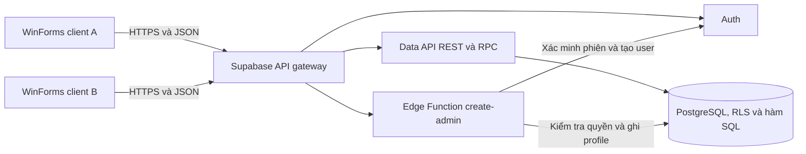
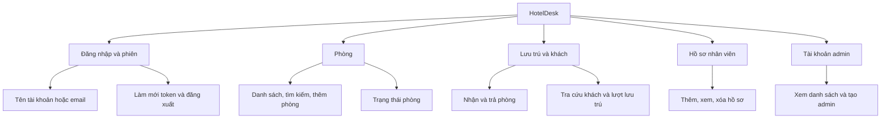
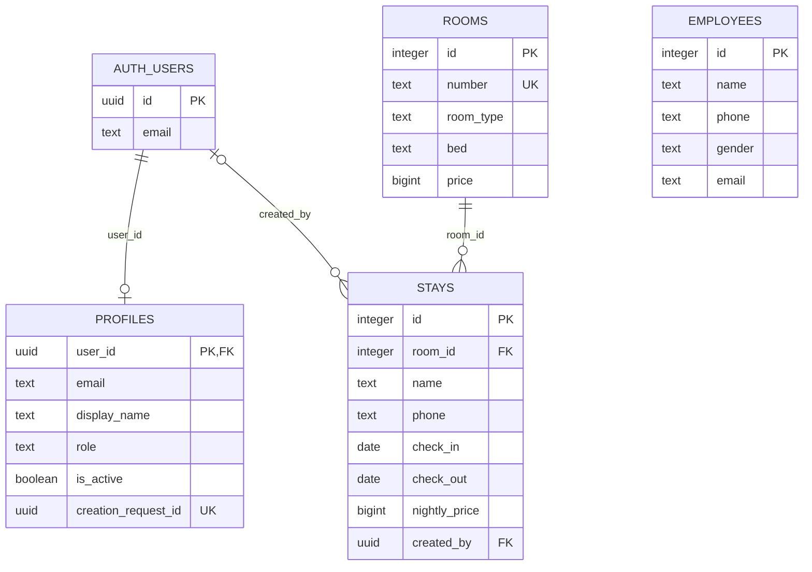
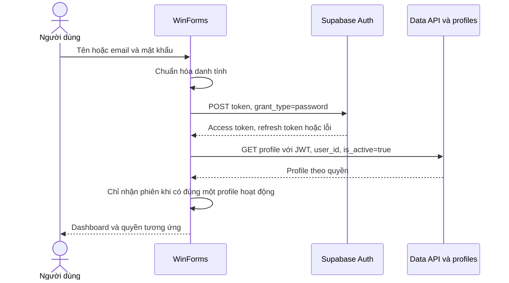
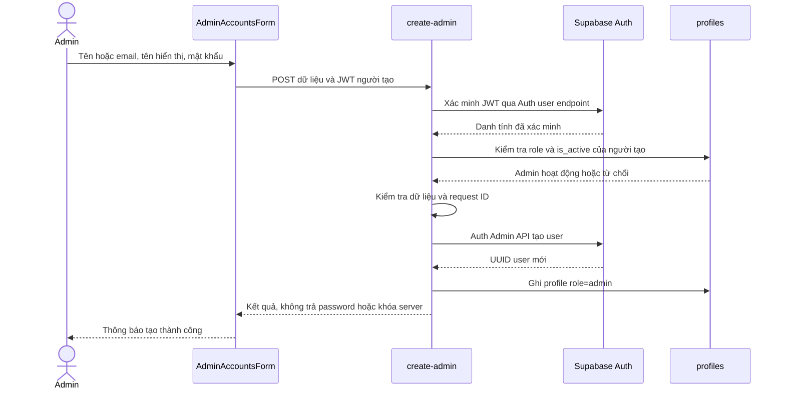

# BÁO CÁO GIỮA KỲ NT106 — NHÓM 4
# Kiến trúc server và triển khai Supabase cho HotelDesk

**Ngày cập nhật:** 25/11/2026.  
**Dự án:** NT106.R11-Nhom4 — ứng dụng desktop quản lý khách sạn.  
**Phạm vi:** mã nguồn hiện tại, project cloud, luồng hoạt động và bằng chứng kiểm thử.  
**Mô hình quyền:** `admin` và `receptionist`; mọi admin có quyền ngang nhau.

> Supabase đã chạy trên cloud. Việc chuyển dữ liệu cũ từ Azure chưa hoàn tất. Tài liệu phân biệt việc đã triển khai, việc đã kiểm thử và phần còn trong kế hoạch; không chứa mật khẩu, token hay khóa quản trị.

## Mục lục

1. Tóm tắt để trình bày trước lớp
2. Bài toán và lý do chuyển đổi
3. Server hiện tại nằm ở đâu?
4. Công nghệ và trách nhiệm từng thành phần
5. Kiến trúc và phân rã chức năng
6. Database và quan hệ các bảng
7. API và hàm nghiệp vụ
8. Đăng nhập và quản lý phiên
9. Admin tạo thêm admin
10. Nhận/trả phòng và chống nhận trùng
11. Đồng bộ nhiều client
12. Phân quyền và bảo vệ dữ liệu
13. Xử lý lỗi
14. Cấu trúc mã nguồn
15. Cấu hình, triển khai và sử dụng chung
16. Chuyển dữ liệu cũ
17. Kiểm thử và trạng thái cloud
18. Tiến độ và hạn chế
19. Kịch bản demo
20. Câu hỏi phản biện
21. Kế hoạch tiếp theo và thuật ngữ
22. Nguồn đối chiếu

---

## 1. Tóm tắt để trình bày trước lớp

### 1.1. Đoạn giới thiệu khoảng một phút

> “HotelDesk là ứng dụng desktop quản lý khách sạn bằng C# WinForms. Nhóm sử dụng Supabase làm backend dùng chung trên cloud. Client giao tiếp qua HTTPS bằng dữ liệu JSON. Supabase Auth xác thực người dùng, PostgreSQL lưu dữ liệu, Data API cung cấp đường truy cập, còn các hàm PostgreSQL xử lý nhận và trả phòng. Với thao tác tạo tài khoản admin, nhóm triển khai một Edge Function để khóa quản trị luôn ở server. Hệ thống hiện có hai quyền admin và lễ tân. Nhiều máy cùng dùng một database; màn hình đang mở cập nhật định kỳ 15 giây. Nhóm đã kiểm tra phân quyền, điều kiện nhận/trả phòng và thử thực tế việc admin tạo thêm admin có thể đăng nhập.”

### 1.2. Những điểm cần nói đúng

- Hệ thống **vẫn có server**, nhưng Supabase vận hành hạ tầng thay vì nhóm tự chạy HotelServer trên máy ảo.
- WinForms gọi API, **không kết nối trực tiếp PostgreSQL bằng tài khoản quản trị**.
- Dùng chung dữ liệu là cùng đọc/ghi một database trung tâm, không sao chép database về từng máy.
- Cập nhật giữa client hiện là **polling 15 giây**, chưa sử dụng Supabase Realtime/WebSocket.
- Không còn quyền cao hơn admin; admin ban đầu và admin tạo sau ngang quyền.
- Chức năng tạo admin đã có backend; xóa/khóa tài khoản chưa có nút riêng trên client.

## 2. Bài toán và lý do chuyển đổi

Nhóm cần nhiều máy tải dự án về, chạy được và thấy cùng dữ liệu phòng, khách, nhân viên. Nếu mỗi máy có database riêng, dữ liệu và cấu hình có thể khác nhau; nhóm khó kiểm tra việc nhiều client cùng làm việc.

Backend còn cần xác thực, phân quyền và bảo đảm hai máy không nhận cùng một phòng đang trống.

| Nội dung | Kiến trúc trước | Kiến trúc hiện tại |
| --- | --- | --- |
| Luồng | WinForms → TCP/TLS → HotelServer trên Azure VM → Azure SQL | WinForms → HTTPS → Supabase → PostgreSQL |
| Server ứng dụng | Nhóm tự chạy HotelServer | Dịch vụ managed và hàm backend do nhóm viết |
| Vận hành | VM, RDP, cổng ứng dụng, cấu hình chạy server | Không cần VM riêng cho backend hiện tại |
| Database | SQL Server/Azure SQL | PostgreSQL trên Supabase |
| Tài khoản | Cơ chế trong hệ thống server cũ | Supabase Auth và bảng phân quyền `profiles` |
| Máy thành viên | Địa chỉ server, cổng và transport | Project URL, public key và tài khoản đăng nhập |

Mục tiêu là giảm công việc vận hành và cấu hình trên từng máy trong thời gian đồ án. Đây là lựa chọn cho phạm vi nhóm, không phải kết luận Azure luôn kém phù hợp hơn Supabase.

**Bỏ Azure trong mã nguồn không tự xóa tài nguyên Azure.** Báo cáo này không xác nhận VM/Azure SQL cũ đã bị xóa hoặc ngừng tính phí. Phải sao lưu, đối chiếu dữ liệu trước khi ngừng hệ thống cũ.

## 3. Server hiện tại nằm ở đâu?

### 3.1. Phân biệt các thành phần

| Khái niệm | Trong dự án |
| --- | --- |
| Client | File exe WinForms trên máy người sử dụng |
| Backend/server | Auth, Data API, PostgreSQL và Edge Function trên Supabase |
| Supabase Dashboard | Website quản lý project và dữ liệu; không phải app lễ tân |

Nhà cung cấp vận hành hạ tầng. Nhóm vẫn chịu trách nhiệm về schema, luật nghiệp vụ, quyền và mã function. Vì vậy “không còn HotelServer.exe” không có nghĩa “không còn xử lý phía server”.

### 3.2. Project đã tạo

| Thuộc tính | Giá trị |
| --- | --- |
| Organization | `Nhom4` |
| Project | `NT106-Nhom4-HotelDesk` |
| Project ref | `gdsoaqpiwbuwwnceksjt` |
| API origin | `https://gdsoaqpiwbuwwnceksjt.supabase.co` |
| Khu vực | Tokyo — `ap-northeast-1` |
| Gói chọn khi thiết lập | Free |
| Edge Function | `create-admin` |

Project URL không phải mật khẩu. Báo cáo không chép giá trị public key vì không cần thiết khi trình bày.

### 3.3. Có cần bật máy cá nhân liên tục không?

Không cần bật laptop người phát triển để các máy khác dùng backend. Client vẫn cần Internet và project cloud phải sẵn sàng. Không nên hứa dịch vụ không bao giờ gián đoạn hoặc không có hạn mức.

Đổi Wi-Fi không cần thêm IP thủ công trong mô hình đang dùng: client gọi API HTTPS công khai, quyền được kiểm tra theo danh tính và policy.

## 4. Công nghệ và trách nhiệm từng thành phần

| Thành phần | Vai trò |
| --- | --- |
| C# / .NET Framework 4.7.2 | Ngôn ngữ và nền tảng app Windows |
| Windows Forms | Cửa sổ, nhập liệu và điều hướng |
| Guna UI2 2.0.3.5 | Các control và tạo kiểu giao diện |
| `HttpClient` | Gửi HTTP request bất đồng bộ |
| JSON / `JavaScriptSerializer` | Chuyển dữ liệu giữa model và API |
| HTTPS | Bảo vệ đường truyền bằng TLS của nền tảng |
| Supabase Auth | Xác thực và cấp phiên |
| Data API/PostgREST | Cung cấp REST và RPC trên PostgreSQL [S1] |
| PostgreSQL | Lưu trữ, ràng buộc, transaction và khóa bản ghi |
| SQL/PL/pgSQL | Luật nhận/trả phòng và kiểm tra quyền |
| Edge Functions | Chạy thao tác quản trị tài khoản ở server |
| TypeScript / Deno | Mã và runtime của Edge Function |
| RLS + GRANT | Quyền thao tác và phạm vi hàng dữ liệu [S2] |
| Supabase CLI 3.4.0 | Triển khai và kiểm tra project |
| Node.js 24 | Chạy kiểm thử handler; không phải điều kiện chạy app |

App hiện gọi REST trực tiếp, **không dùng Supabase C# SDK**. Máy chỉ chạy exe không cần Node, Deno hay PostgreSQL local. Các công cụ phát triển phục vụ từng bước build/test/deploy.

## 5. Kiến trúc và phân rã chức năng

### 5.1. Kiến trúc tổng thể



Nếu trình xem không hỗ trợ Mermaid, đọc sơ đồ theo dòng:

```text
Nhiều client → HTTPS → Supabase → Auth + Data API + Edge Function + PostgreSQL
```

### 5.2. Phân rã chức năng hiện có



Sơ đồ không khẳng định đã có đầy đủ sửa/xóa phòng, hóa đơn, thanh toán hay đặt phòng online.

### 5.3. Một request đi qua mã nguồn

```text
View nhận thao tác
  → Service chọn API
  → HotelSession cung cấp token hợp lệ
  → SupabaseClient tạo request/JSON
  → Server kiểm tra quyền, thực hiện nghiệp vụ
  → JSON response → model C# → View cập nhật
```

Ẩn nút trên UI chỉ hỗ trợ trải nghiệm. Quyền thực hiện phải được kiểm tra ở backend.

## 6. Database và quan hệ các bảng

### 6.1. Sơ đồ quan hệ



`AUTH_USERS` đại diện bảng do Supabase Auth quản lý; hình chỉ nêu trường cần giải thích, không phải toàn bộ bảng nội bộ.

### 6.2. Auth user và profile

| Bảng | Nội dung |
| --- | --- |
| `auth.users` | Danh tính đăng nhập do Auth quản lý |
| `public.profiles` | Tên hiển thị, vai trò và trạng thái dùng dữ liệu khách sạn |

Các trường `profiles`:

| Trường | Ý nghĩa |
| --- | --- |
| `user_id` | UUID, khóa chính, tham chiếu Auth user |
| `email` | Email thật hoặc email kỹ thuật |
| `display_name` | Tên hiển thị, 1–100 ký tự |
| `role` | `admin` hoặc `receptionist` |
| `is_active` | Còn hoạt động hay đã khóa quyền nghiệp vụ |
| `creation_request_id` | UUID duy nhất để nhận diện yêu cầu tạo tài khoản |

Mật khẩu không nằm trong `profiles`. Xóa Auth user sẽ xóa profile tương ứng bằng `ON DELETE CASCADE`.

### 6.3. Bảng `rooms`

| Trường | Ý nghĩa/ràng buộc |
| --- | --- |
| `id` | Mã tự tăng |
| `number` | Số/tên phòng duy nhất, có kiểm tra độ dài và nội dung |
| `room_type` | Loại phòng |
| `bed` | Loại giường |
| `price` | Giá theo đêm, số nguyên không âm |

Schema mới không lưu cột `booked`. Phòng có khách khi tồn tại lượt lưu trú chưa trả. Trạng thái được tính từ dữ liệu chính, tránh cột phòng và bảng khách bị lệch nhau.

### 6.4. Bảng `stays`

Một dòng là **một lượt lưu trú**, chưa phải hồ sơ khách độc lập dùng chung cho nhiều booking.

| Nhóm | Các trường |
| --- | --- |
| Định danh | `id`, `room_id` |
| Khách | `name`, `phone`, `nationality`, `gender`, `birth_date`, `identity_document`, `address` |
| Thời gian | `check_in`, `check_out` |
| Giá/người thao tác | `nightly_price`, `created_by` |

Ràng buộc quan trọng:

- Phòng phải tồn tại; tên và giấy tờ không được rỗng theo schema.
- `check_out` trống nghĩa là đang ở; nếu có thì không trước `check_in`.
- Ngày sinh nếu có không sau ngày nhận phòng.
- Số điện thoại lưu bằng chuỗi để giữ số 0 đầu, có kiểm tra định dạng.
- `nightly_price` không âm và được chụp từ giá phòng khi nhận phòng.
- `created_by` ghi UUID người thao tác. Xóa Auth user chỉ đặt trường này về NULL, không xóa lượt lưu trú.

Chỉ mục duy nhất có điều kiện:

```sql
create unique index one_active_stay_per_room
on public.stays(room_id)
where check_out is null;
```

Mỗi phòng chỉ có tối đa một lượt lưu trú đang hoạt động, kể cả khi nhiều client thao tác. Giá lưu trú đã ghi không bị thay bằng giá phòng hiện tại khi đọc danh sách.

### 6.5. Bảng `employees`

Gồm `id`, `name`, `phone`, `gender`, `email`. Đây là **hồ sơ nhân sự**, không có cột mật khẩu.

Thêm/xóa hồ sơ nhân viên không tự tạo/xóa tài khoản Auth. Có hồ sơ nhân sự không đồng nghĩa được đăng nhập app.

## 7. API và hàm nghiệp vụ

### 7.1. Endpoint client sử dụng

Các đường dẫn được nối sau Project URL. Query string lọc/chọn cột được rút gọn trong bảng.

| HTTP | Endpoint | Mục đích |
| --- | --- | --- |
| POST | `/auth/v1/token?grant_type=password` | Đăng nhập |
| POST | `/auth/v1/token?grant_type=refresh_token` | Làm mới phiên |
| POST | `/auth/v1/logout?scope=local` | Đăng xuất phiên tương ứng |
| GET | `/rest/v1/profiles?...` | Đọc hồ sơ/quyền và danh sách theo RLS |
| POST | `/rest/v1/rpc/hotel_get_rooms` | Phòng và trạng thái |
| POST | `/rest/v1/rooms?...` | Thêm phòng |
| POST | `/rest/v1/rpc/hotel_get_customers` | Lọc khách/lượt lưu trú |
| POST | `/rest/v1/rpc/hotel_check_in` | Nhận phòng |
| POST | `/rest/v1/rpc/hotel_check_out` | Trả phòng |
| GET | `/rest/v1/employees?...` | Xem nhân viên |
| POST | `/rest/v1/employees?...` | Thêm nhân viên |
| DELETE | `/rest/v1/employees?id=eq...` | Xóa hồ sơ nhân viên |
| POST | `/functions/v1/create-admin` | Tạo Auth user và profile admin |

RPC ở đây là gọi hàm PostgreSQL qua Data API HTTPS. Nó không phải giao thức TCP/JSON của HotelServer cũ. [S1][S4]

### 7.2. Các hàm SQL

| Hàm | Trách nhiệm |
| --- | --- |
| `hotel_get_rooms()` | Tính trạng thái từ `stays`, trả JSON danh sách |
| `hotel_get_customers(p_status,p_name)` | Lọc tất cả/đang ở/đã trả, tìm tên, ghép phòng |
| `hotel_check_in(p_customer)` | Khóa phòng, kiểm tra trống, ghi lưu trú và giá |
| `hotel_check_out(p_stay_id,p_date)` | Khóa, kiểm tra và ghi ngày trả |
| `private.is_staff()` | Profile hoạt động có role admin/lễ tân |
| `private.is_admin()` | Profile hoạt động có role admin |

Các hàm nghiệp vụ đặc quyền dùng `SECURITY DEFINER`, `search_path` rỗng và chủ động kiểm tra quyền đầu hàm. Không nên nói mọi lệnh trong những hàm này đều tự được RLS lọc như truy vấn client: hàm có thể chạy với quyền chủ hàm nên phải có kiểm tra rõ ràng.

## 8. Đăng nhập và quản lý phiên

### 8.1. Tên tài khoản được chuyển thành danh tính Auth

```text
Long → long → long@staff.hoteldesk.invalid → Supabase Auth
```

Đây là quy ước trong `LoginIdentity.cs`, không phải một loại username native của Supabase. Người dùng vẫn nhập đúng mật khẩu đã đặt; app không tự nối ký tự hoặc biến mật khẩu `123` thành mật khẩu khác.

Tên tài khoản không phân biệt hoa/thường. Email kỹ thuật `.invalid` không nhận thư; không dùng nó để gửi OTP/xác nhận hay khôi phục qua hộp thư. Người cần nhận thư nên dùng email thật.

### 8.2. Luồng đăng nhập



Auth trả lời “người dùng là ai”; profile trả lời “có được sử dụng dữ liệu khách sạn và có quyền gì”. Auth user chưa có profile hoạt động không vào Dashboard qua luồng hiện tại.

### 8.3. Phiên đăng nhập

- Access token gửi trong `Authorization: Bearer ...`; refresh token dùng xin phiên mới.
- `HotelSession` chỉ giữ token trong bộ nhớ, chưa ghi nhớ phiên sau khi đóng app.
- Thời điểm làm mới dựa trên `expires_in` do Auth trả, trừ trước 60 giây; không gán thời hạn cố định cho mọi project.
- `SemaphoreSlim` tuần tự hóa các thao tác phiên, tránh nhiều request cùng refresh.
- API trả 401 thì client xóa phiên và yêu cầu đăng nhập lại.
- Đăng xuất gọi Auth rồi xóa trạng thái client. Đóng cửa sổ dọn bộ nhớ, không có nghĩa thu hồi mọi phiên trên mọi thiết bị.

Supabase Auth quản lý việc lưu băm mật khẩu; tài liệu chính thức nêu dùng bcrypt. Nhóm không tự lưu mật khẩu rõ trong bảng nhân viên. [S3]

## 9. Admin tạo thêm admin

### 9.1. Ma trận quyền hiện tại

| Thao tác | Admin | Receptionist |
| --- | --- | --- |
| Xem, tìm và thêm phòng | Có | Có |
| Nhận/trả và tra cứu lưu trú | Có | Có |
| Thêm/xem/xóa hồ sơ nhân viên | Có | Không |
| Xem danh sách tài khoản | Có | Chỉ profile của chính mình theo policy |
| Tạo admin từ app | Có | Không |
| Tự ghi role qua API bảng profiles | Không | Không |

Admin ban đầu và admin tạo sau đều là `admin`. Email admin đầu tiên không còn là điều kiện ưu tiên trong function.

### 9.2. Vì sao cần Edge Function?

Auth Admin API cần đặc quyền server. Nhúng khóa đó trong exe sẽ khiến người có client có thể lấy và sử dụng. Vì vậy client chỉ gửi JWT của người đăng nhập; function mới dùng khóa môi trường server để tạo người dùng. Tài liệu Supabase yêu cầu giữ thao tác này ở phía server. [S5]

### 9.3. Luồng tạo tài khoản



Tài khoản mới dùng **cùng màn hình Login**, không cần tạo lại thủ công ở Dashboard sau khi luồng này thành công. Mọi admin mới đều có thể tạo tiếp admin khác.

### 9.4. Các kiểm tra của function

1. Chỉ nhận POST và bearer token.
2. Xác minh token bằng Auth, không chỉ giải mã JWT rồi tin nội dung.
3. Đọc profile thật, kiểm tra `role = admin` và `is_active = true`.
4. Chuẩn hóa danh tính; kiểm tra tên, mật khẩu và UUID yêu cầu.
5. Luôn gán `admin` ở server; không lấy role do client gửi.
6. App/function yêu cầu mật khẩu 6–128 ký tự; Auth kiểm tra thêm chính sách project.
7. `email_confirm = true` phục vụ cấp tài khoản nội bộ bởi admin, không phải bằng chứng đã xác minh quyền sở hữu hộp thư thật.

### 9.5. Nếu tạo Auth user được nhưng ghi profile lỗi

Auth API và Data API không nằm trong một transaction của nhóm. Function kiểm tra lại người dùng/request ID khi phản hồi ghi profile bị mất. Nếu đã ghi đúng thì trả thành công; nếu cần hoàn tác thì chỉ xóa user vừa tạo trong yêu cầu đó. Không xác định/hoàn tác được do mạng thì yêu cầu kiểm tra danh sách trước khi tạo lại.

`creation_request_id` hỗ trợ nhận diện kết quả và yêu cầu lặp, không biến hai dịch vụ thành một giao dịch nguyên tử. UI tạo ID cho lần bấm mới và không tự retry thao tác ghi.

### 9.6. Xóa/khóa tài khoản

Client hiện chưa có nút xóa/khóa. Có thể xóa user trên Supabase Auth; profile sẽ xóa theo. Đặt `profiles.is_active = false` chặn quyền nghiệp vụ, không đồng nghĩa Auth user bị xóa hoặc JWT bị thu hồi ngay. Nên giữ ít nhất một admin hoạt động.

## 10. Nhận/trả phòng và chống nhận trùng

### 10.1. Nhận phòng

1. Client lấy phòng, lọc loại/giường và cho chọn phòng trống.
2. Nhập khách và ngày nhận, gọi `hotel_check_in`.
3. Server kiểm tra quyền, khóa phòng bằng `SELECT ... FOR UPDATE`.
4. Kiểm tra lại có lượt đang ở hay chưa; không tin danh sách cũ của client.
5. Ghi lượt lưu trú, lấy giá từ database và người thao tác từ `auth.uid()`.
6. Trả mã lưu trú, client tải lại.

### 10.2. Hai máy cùng nhận phòng 101

| Thời điểm | Client A | Client B | Database |
| --- | --- | --- | --- |
| Đầu tiên | Thấy trống | Thấy trống | Chưa có lượt đang ở |
| A gửi trước | Đang xử lý | Gửi gần cùng lúc | A khóa phòng |
| A hoàn thành | Nhận mã lưu trú | Chờ xử lý | Có lượt đang ở |
| B được xử lý | — | Bị báo phòng vừa được nhận | Server kiểm tra lại trạng thái |

Khóa tuần tự hóa thao tác; partial unique index bổ sung ràng buộc. “UI hiện trống” không bảo đảm request nhận phòng sẽ thành công.

SQL test đã kiểm tra nhận trùng bị chặn. Đây chưa phải bài đo tải đồng thời quy mô lớn.

### 10.3. Trả phòng

Server tìm lượt lưu trú, khóa phòng trước rồi khóa lượt lưu trú theo thứ tự nhất quán. Nó từ chối lượt không tồn tại, đã trả hoặc ngày trả trước ngày nhận. Ghi `check_out` khiến phòng được tính lại thành trống.

Phạm vi này là **kết thúc lưu trú**, chưa phải thu tiền, thanh toán QR, đối soát ngân hàng hoặc xuất hóa đơn hoàn chỉnh.

## 11. Đồng bộ nhiều client

Các máy dùng cùng project/database. Một máy ghi thành công thì dữ liệu trung tâm đổi; máy khác nhìn thấy sau lần đọc tiếp theo. Không cần merge file database giữa các máy qua Git.

Cơ chế cụ thể:

- `CloudScreen` có Timer `Interval = 15000` mili giây.
- Màn hình đang hiển thị và có phiên mới tải lại.
- Chuyển trang/nút tải lại có thể yêu cầu đọc sớm hơn.
- Cùng một app phát `ROOMS_CHANGED`, `CUSTOMERS_CHANGED`, `EMPLOYEES_CHANGED` sau ghi thành công để làm mới màn hình liên quan.
- Đây là sự kiện C# nội bộ, không phải server đẩy thông báo tới các máy khác.
- Cờ `loading`/`pending` gom yêu cầu; `BeginInvoke` đưa cập nhật về UI thread.

Độ trễ gồm khoảng chờ polling và thời gian mạng/server. Không cam kết luôn tối đa 15 giây khi mạng lỗi hoặc request trước chưa xong.

| Hiện tại | Hướng có thể bổ sung |
| --- | --- |
| Timer + REST polling | Realtime/WebSocket và subscription |
| Client chủ động hỏi | Server gửi sự kiện |
| Gọi là cập nhật định kỳ | Chỉ gọi Realtime sau khi triển khai và thử |

Supabase có dịch vụ Realtime, nhưng app này chưa sử dụng nó. [S6]

## 12. Phân quyền và bảo vệ dữ liệu

### 12.1. GRANT và RLS

GRANT cho role database loại quyền trên đối tượng. RLS giới hạn hàng khi thao tác áp dụng policy. Cần xem cả hai, không chỉ bật RLS hoặc ẩn nút UI. [S2]

| Đối tượng | Quyền chính |
| --- | --- |
| profiles | Đọc hồ sơ mình; admin hoạt động đọc danh sách; client không tự ghi role |
| rooms | Nhân sự hoạt động SELECT/INSERT |
| stays | Không ghi trực tiếp từ client; dùng các hàm kiểm tra quyền |
| employees | Admin hoạt động SELECT/INSERT/DELETE |
| create-admin | Xác minh Auth và role trước khi sử dụng đặc quyền server |

Hàm `private.is_admin()` đọc profile với quyền chủ hàm, tránh policy đọc profile gọi đệ quy chính nó. Schema `private` không được ứng dụng dùng làm Data API công khai.

### 12.2. Phân biệt thông tin kết nối

| Thông tin | Nơi dùng | Ý nghĩa |
| --- | --- | --- |
| URL + publishable key | Client/config | Xác định project/ứng dụng; không phải quyền admin |
| Access/refresh token | Bộ nhớ phiên client | Đại diện người dùng |
| Service role key | Môi trường function | Đặc quyền server, không phân phối trong exe/Git |

Client dùng `apikey` cho public key và `Authorization` cho JWT. Function có `verify_jwt = true` và vẫn xác minh người dùng qua Auth. [S7]

`SupabaseSettings` từ chối secret/service role key trong cấu hình client, giúp tránh đặt nhầm khóa; nó không thay thế RLS.

### 12.3. Đường truyền và log

HTTPS mã hóa đường truyền. Password vẫn cần đi tới Auth khi đăng nhập hoặc function khi tạo tài khoản; không nên nói “mật khẩu không bao giờ rời máy”. Mã không ghi password/token/key vào log và không trả password/service key trong response tạo admin.

App dựa vào HTTPS của hệ điều hành và chứng chỉ Supabase, không còn dùng chứng chỉ tự cấp/pin của HotelServer cũ.

## 13. Xử lý lỗi

| Tình huống | Cách xử lý/ý nghĩa |
| --- | --- |
| Sai đăng nhập | Hiện lỗi, xóa ô mật khẩu |
| Auth user thiếu profile hoạt động | Không nhận phiên Dashboard |
| 401 | Xóa phiên client, yêu cầu đăng nhập lại |
| 403 | Thiếu quyền |
| 409 khi tạo tài khoản | Đã tồn tại/request không phù hợp; kiểm tra danh sách |
| 429 | Quá nhiều yêu cầu, thử lại sau |
| 5xx | Backend tạm lỗi; không suy ra chắc chắn chưa ghi |
| Quá 30 giây ở client | Báo timeout, yêu cầu kiểm tra trước khi gửi lại |
| Function chưa deploy | Báo chức năng quản lý tài khoản chưa triển khai |
| Nhận phòng trùng | Server từ chối thao tác không còn hợp lệ |

Function đặt timeout 15 giây cho từng request nội bộ; thao tác nhiều bước có thể lâu hơn một request đơn lẻ.

**Timeout không chứng minh server chưa ghi dữ liệu.** Có lần thử tạo tài khoản bị timeout ở phía gọi nhưng kiểm tra sau thấy bản ghi đã được tạo. Vì vậy không tự retry ghi. Lần thử kế tiếp đã hoàn thành chuỗi tạo/đăng nhập và dọn các tài khoản thử.

## 14. Cấu trúc mã nguồn

```text
ChuuongTrinhQuanLyKhachSan.sln
├── Program.cs, App.config
├── Views/
│   ├── LoginForm, DashboardForm
│   ├── SessionForm, AdminAccountsForm
│   └── Controls/
│       ├── RoomsControl, CheckInControl, CheckOutControl
│       └── CustomersControl, EmployeesControl
├── Models/
├── Services/
│   ├── LoginIdentity, HotelSession
│   └── RoomService, HotelServices, AccountService
├── Infrastructure/
│   └── SupabaseSettings, SupabaseClient
├── UI/
│   └── UiTheme, OverviewPage, CloudScreen
├── supabase/
│   ├── migrations/
│   ├── functions/create-admin/
│   ├── tests/
│   └── config.toml
├── scripts/
├── tests/
└── docs/
```

| Lớp/thư mục | Cần tìm ở đây |
| --- | --- |
| Views | Thao tác và hiển thị cho người dùng |
| Models | Kiểu dữ liệu C#, tên dễ đọc như `RoomId`, `DisplayName` |
| Services | Chọn endpoint và nối nghiệp vụ |
| Infrastructure | HTTPS, JSON, cấu hình, lỗi |
| UI | Tạo kiểu và lịch tải lại |
| SQL | Cấu trúc, quyền và giao dịch dùng chung |
| Edge Function | Tạo tài khoản bằng quyền server |

Designer chỉ phục vụ bố cục, không chứa truy vấn HTTP/SQL nghiệp vụ. Một số API dùng alias trong `select` để đổi tên cột snake_case thành thuộc tính PascalCase của C#.

## 15. Cấu hình, triển khai và sử dụng chung

### 15.1. Các file cấu hình

- `App.config`: URL/public key project nhóm.
- `App.local.config`: cấu hình tùy chọn trên máy, dùng khi build, được Git bỏ qua.
- `*.exe.config`: cấu hình bên cạnh exe đã build.
- `supabase/config.toml`: kiểm tra JWT của function.
- `.gitignore`: bỏ cấu hình cá nhân, build output, package và bản xuất dữ liệu `.local`.

### 15.2. Thành viên chạy app

```powershell
# Chạy tại thư mục có solution
.\scripts\Build-Team.ps1 -Configuration Debug
```

Mở solution và chạy project `ChuuongTrinhQuanLyKhachSan`, hoặc bản exe. Khi phát hành exe phải gửi cả output gồm DLL và `.exe.config`, không gửi một exe riêng.

Máy thành viên không cần nhập mật khẩu PostgreSQL, chạy HotelServer, cài database local hay mở TCP 8888.

### 15.3. Triển khai backend

Project mới dùng schema 001 và bản quyền admin hiện tại 003; tạo/cấp admin đầu tiên theo hướng dẫn setup. Script phân cấp cũ đã đưa ra ngoài dự án; chỉ giữ schema 001 và migration admin 003 cần thiết. Project nhóm đã cập nhật, không chạy lại schema 001 lên database hiện tại.

Các lệnh sau là ví dụ vận hành, không phải yêu cầu chạy lại để demo:

```powershell
npx --yes supabase@3.4.0 login
npx --yes supabase@3.4.0 functions deploy create-admin `
  --remote=gdsoaqpiwbuwwnceksjt --use-api --yes
```

Tài khoản CLI/Dashboard quản lý hạ tầng độc lập với Auth user đăng nhập app, kể cả cùng email. File SQL có thể đã chạy qua SQL Editor/CLI query mà chưa được ghi nhận trong migration tracking; không dựa riêng vào màn hình “last migration” để chạy lại schema.

### 15.4. Đồng bộ nhóm qua Git

- Git chia sẻ mã/script/tài liệu; dữ liệu đang chạy ở Supabase.
- Không push password, service key, token hoặc bản xuất dữ liệu khách.
- Không bắt buộc Connect GitHub với Supabase; function hiện deploy riêng qua CLI.
- Nhánh local hiện là `feature/supabase-migration`. Các thay đổi của đợt này chưa commit/push tại thời điểm lập báo cáo; cloud có thể mới hơn bản đã chia sẻ trên GitHub.

## 16. Chuyển dữ liệu cũ

Backend mới đã chạy nhưng **chưa hoàn tất nhập dữ liệu thật từ Azure**. Tạo project và chạy migration không đồng nghĩa chuyển dữ liệu xong.

`Convert-LegacyData.ps1` đọc JSON xuất từ `rooms`, `customer`, `employee` cũ và sinh SQL nhập schema mới, không yêu cầu đưa mật khẩu Azure vào mã nguồn.

| Cũ | Mới |
| --- | --- |
| rooms | rooms |
| customer | stays |
| employee | employees |
| staff_accounts, mật khẩu cũ | Tạo lại danh tính Auth và cấp profile |

Script giữ ID, đặt lại bộ đếm, kiểm tra phòng và lượt đang ở có khớp, từ chối ngày không hợp lệ thay vì đoán. Không nhập mật khẩu/hash cũ vào Auth.

**Giới hạn lịch sử giá:** bảng cũ không có giá chụp cho từng lượt lưu trú; converter lấy giá phòng tại lúc chuyển. Không thể khẳng định phục hồi chính xác giá lịch sử nếu phòng từng đổi giá.

Các bước còn lại: ngừng ghi hệ thống cũ → sao lưu/xuất ngoài Git → chuyển/nhập → đối chiếu dòng, liên kết, trạng thái, ngày → kiểm tra app → thống nhất cả nhóm dùng bản mới → quyết định ngừng tài nguyên cũ.

Hai database độc lập không tự đồng bộ nếu vẫn ghi song song ở hệ thống cũ và mới.

## 17. Kiểm thử và trạng thái cloud

### 17.1. Snapshot kiểm tra chỉ đọc

Khoảng **15:14 ngày 25/11/2026, UTC+7**:

| Chỉ số | Kết quả |
| --- | --- |
| Admin hoạt động | 2 |
| rooms / stays / employees | 0 / 0 / 0 |
| Bảng nghiệp vụ bật RLS | 4/4 |
| Role ngoài admin/receptionist | 0 |
| create-admin | ACTIVE, version 2 |
| Kiểm tra JWT function | Bật |

Đây là snapshot, không phải số liệu cố định. Dữ liệu có thể thay đổi sau đó. Các bảng đang trống nên cần chuẩn bị phòng/khách giả trước buổi demo nhận/trả.

### 17.2. Kết quả đã ghi nhận

| Kiểm thử | Môi trường/phạm vi | Kết quả |
| --- | --- | --- |
| Build Debug/Release | Máy phát triển | Đạt |
| Username, login, refresh, lỗi, không retry ghi | HTTP mô phỏng, C# | Đạt |
| Admin được tạo tài khoản; lễ tân/khóa bị chặn | Handler TypeScript mô phỏng | Đạt |
| Không tin role payload, không trả password/key | Handler mô phỏng | Đạt |
| Lỗi profile, kiểm tra lại, hoàn tác user mới | Handler mô phỏng | Đạt |
| Schema mới/nâng cấp mô hình cũ | PostgreSQL trong bộ nhớ, Auth interface mô phỏng | Đạt |
| Hai admin ngang quyền, bảo vệ role | SQL trên cloud, fixture rollback | Đạt |
| Nhận trùng, ngày trả không hợp lệ | Bộ SQL test | Đạt trong phạm vi fixture |
| Bố cục Login, sáu màn hình, form tạo admin | Control WinForms nhiều kích thước | Đạt |
| Chuyển dữ liệu giả, số 0 đầu, dấu nháy | Script và PostgreSQL trong bộ nhớ | Đạt |
| Admin 1 tạo admin 2; admin 2 đăng nhập/tạo admin 3; admin 3 đăng nhập | Auth và Edge Function thật | Đạt, đã dọn tài khoản thử |

Lần thử cloud đầu gặp timeout dù đã ghi; lần thử tiếp theo hoàn tất với phản hồi tạo tài khoản khoảng 1,4 giây và 0,8 giây. Đây là số đo của hai lần gọi, **không phải SLA hoặc benchmark chung**.

Layout test dựng control và `DrawToBitmap`, không thay thế mọi kiểm tra DPI trực quan. SQL test không thay cho stress test. Luồng đăng nhập cloud được thử qua Auth API; vẫn cần demo trực tiếp bằng app để chứng minh UI đầy đủ trước lớp.

### 17.3. Cách chạy lại

```powershell
.\scripts\Test-Supabase.ps1
.\scripts\Test-LegacyConversion.ps1
.\scripts\Test-ClientUi.ps1
node .\tests\CreateAdminChecks.mjs
```

Đây là các test offline. Hai test database là `supabase/tests/permissions_and_stays.sql` và `supabase/tests/admin_accounts.sql`, dùng fixture trong transaction rollback. Xem nội dung trước khi chạy kiểm thử có ghi trên database đang dùng.

Workflow GitHub đã cấu hình build và test offline. Vì thay đổi chưa push, không khẳng định workflow mới đã có run thành công trên GitHub.

## 18. Tiến độ và hạn chế

| Hạng mục | Trạng thái cần trình bày |
| --- | --- |
| Tái cấu trúc, bỏ phụ thuộc HotelServer/Azure trong mã chạy | Đã làm |
| Project, schema, RLS, Auth, function tạo admin | Đã thiết lập/triển khai |
| Tạo admin và đăng nhập bằng tài khoản mới | Đã thử API cloud thật |
| Hai quyền admin/lễ tân | Đã triển khai, admin ngang quyền |
| Phòng, khách, nhận/trả, nhân viên | Có UI/service và luật server; cần dữ liệu demo |
| Database chung, cập nhật định kỳ | Có polling, chưa dùng Realtime |
| Chuyển dữ liệu Azure | Có công cụ, chưa hoàn tất dữ liệu thật |
| Xóa/khóa Auth user từ client | Chưa có UI/hàm riêng |
| Google/OTP, quên/đổi mật khẩu, nhớ phiên lâu dài | Chưa triển khai đầy đủ |
| Đặt phòng online/giao diện khách | Chưa hoàn thành |
| QR, đối soát, email xác nhận thanh toán | Chưa hoàn thành |
| Chat lễ tân, chat AI | Chưa triển khai |
| Màn hình phụ khách | Chưa hoàn thành trong backend hiện tại |
| Stress test, đánh giá tải | Chưa có số liệu đầy đủ |

Không quy đổi thành phần trăm hoặc gán đóng góp thành viên nếu chưa đối chiếu bằng chứng phân công.

## 19. Kịch bản demo

### 19.1. Chuẩn bị

- Kiểm tra Internet, project và client đúng cấu hình.
- Có tài khoản admin; không chiếu password/key.
- Tạo vài phòng và dữ liệu khách giả, không dùng thông tin khách thật.
- Chuẩn bị hai cửa sổ, tốt hơn là hai máy.
- Chạy thử trước giờ báo cáo, không chạy lại schema 001 lên database đã có bảng.

### 19.2. Trình tự 8–10 phút

| Bước | Trình bày | Cần cho thấy |
| --- | --- | --- |
| 1 | Sơ đồ kiến trúc | Vai trò client, Auth, API, DB và function |
| 2 | Login admin | Dashboard, mục Tài khoản admin |
| 3 | Tạo admin demo | Danh sách có tài khoản mới |
| 4 | Login tài khoản mới ở cửa sổ khác | Cùng Login, có quyền admin và mở được quản lý tài khoản |
| 5 | Thêm phòng ở client A | B tải lại/đợi polling thấy thay đổi |
| 6 | Nhận phòng | Phòng có khách, có lượt lưu trú |
| 7 | Nhận lại cùng phòng | Bị chặn; nếu UI đã lọc thì giải thích lớp server bằng SQL test |
| 8 | Trả phòng | Ngày hợp lệ, phòng về trống |
| 9 | Login lễ tân nếu đã chuẩn bị | Không được quản lý nhân viên/admin |
| 10 | Tiến độ | Nêu đúng polling và phần còn lại |

Tài khoản mới là Auth user riêng; không cần đăng xuất người tạo để nó tồn tại.

Nếu lỗi mạng: nói rõ lỗi, đọc lại dữ liệu trước khi gửi lại. Có thể trình bày sơ đồ, mã hàm và bằng chứng kiểm thử; không kết luận “chưa tạo” chỉ vì client bị timeout.

## 20. Câu hỏi phản biện

**Còn tự xây server không?** Nhóm không vận hành HotelServer TCP trên VM; vẫn xây logic backend bằng SQL, RLS và Edge Function trên Supabase.

**Có còn client–server không?** Có. Client gửi request; cloud xác thực, xử lý và lưu dữ liệu. Cách vận hành hạ tầng thay đổi, vai trò vẫn còn.

**Vì sao không thêm IP từng máy?** API HTTPS dùng xác thực và quyền dữ liệu, không đòi IP cá nhân cố định trong cấu hình hiện tại.

**Mọi thao tác đều qua Edge Function?** Không. Nghiệp vụ dùng REST/RPC; function riêng phục vụ Auth Admin tạo tài khoản.

**RPC và REST khác nhau thế nào ở đây?** RPC là một endpoint HTTP để gọi hàm PostgreSQL; giúp gom luật/giao dịch phía database.

**Sửa client cho lễ tân hiện nút tạo admin thì sao?** UI hiện nút không cấp quyền. Function vẫn xác minh JWT và role thật.

**Ai là admin cao nhất?** Không có cấp khác. Tất cả admin ngang quyền, tài khoản đầu tiên cũng vậy.

**Admin tạo sau dùng Login cũ được không?** Có, vì function tạo cả Auth user và profile.

**Tên Long được xác thực thế nào?** App ánh xạ sang email kỹ thuật quy ước rồi dùng Auth; không tự xây bảng mật khẩu username.

**Vì sao không dùng 123?** App/function kiểm tra ít nhất 6 ký tự, Auth áp dụng thêm chính sách project. Không có xử lý biến mật khẩu ngắn thành mật khẩu khác.

**Dữ liệu cập nhật tức thời không?** Máy vừa ghi dùng sự kiện nội bộ, máy khác polling/tải lại. Chưa dùng server push.

**Chống nhận trùng bằng gì?** Transaction, khóa phòng, kiểm tra lại và partial unique index.

**Tắt laptop phát triển thì sao?** Các client khác vẫn dùng cloud nếu project/mạng sẵn sàng.

**Đã chuyển hết database Azure chưa?** Chưa. Backend mới chạy; công cụ đã thử với dữ liệu giả, dữ liệu thật còn phải nhập/đối chiếu.

**Trả phòng đã là thanh toán QR chưa?** Chưa. Hiện kết thúc lưu trú, không đối soát tiền.

**Gói Free bảo đảm mọi lúc không?** Không cam kết như vậy. Theo dõi tình trạng/hạn mức, thử trước buổi demo; chưa có chứng nhận tải hoặc độ sẵn sàng.

## 21. Kế hoạch tiếp theo và thuật ngữ

### 21.1. Hướng tiếp theo

1. Nhập/đối chiếu dữ liệu cũ và ổn định dữ liệu demo.
2. Thêm khóa/xóa tài khoản từ app, bảo đảm còn ít nhất một admin.
3. Bổ sung phân trang/giới hạn truy vấn khi dữ liệu tăng; danh sách hiện tại chưa có phân trang hoàn chỉnh.
4. Kiểm thử nhiều client/DPI, mạng yếu và đo thời gian có hệ thống.
5. Phát triển từng phần đặt online, QR, email, chat với schema/quyền/test riêng.
6. Cân nhắc Realtime khi cần độ trễ thấp, xử lý reconnect thay vì chỉ bật dịch vụ.

Đây là kế hoạch, không phải thành quả đã triển khai.

### 21.2. Thuật ngữ nhanh

| Từ | Ý nghĩa |
| --- | --- |
| Client | App trên máy người dùng |
| Backend/server | Dịch vụ xử lý và lưu dữ liệu |
| Managed service | Nhà cung cấp vận hành hạ tầng, nhóm cấu hình và viết logic |
| Endpoint | Đường API |
| HTTPS | HTTP được bảo vệ bằng TLS |
| JSON | Cấu trúc dữ liệu trao đổi |
| Authentication | Xác thực danh tính |
| Authorization | Kiểm tra quyền |
| JWT | Token có chữ ký; phải xác minh trước khi tin |
| Refresh token | Dùng xin phiên mới |
| Publishable key | Khóa client, không thay quyền người dùng |
| Service role key | Khóa đặc quyền server |
| RLS | Quy tắc truy cập hàng dữ liệu |
| GRANT | Cấp loại quyền trên đối tượng DB |
| RPC | Gọi hàm PostgreSQL qua API trong dự án |
| Transaction | Nhóm thao tác thành một giao dịch |
| Row lock | Khóa bản ghi để phối hợp đồng thời |
| Partial unique index | Duy nhất cho các hàng thỏa điều kiện |
| Polling | Chủ động hỏi theo chu kỳ |
| Edge Function | Hàm server gọi qua HTTPS |
| Migration | Script đổi cấu trúc/luật DB |
| Rollback | Hoàn tác trong transaction hoặc bước bù theo thiết kế |

## 22. Nguồn đối chiếu

### 22.1. Mã nguồn dự án

Các đường dẫn tính từ gốc repository:

| Nội dung | File |
| --- | --- |
| Login, refresh, logout | `Services/HotelSession.cs` |
| Username | `Services/LoginIdentity.cs` |
| HTTP, JSON, lỗi, timeout | `Infrastructure/SupabaseClient.cs` |
| Cấu hình và loại khóa | `Infrastructure/SupabaseSettings.cs` |
| Phòng | `Services/RoomService.cs` |
| Lưu trú, nhân viên | `Services/HotelServices.cs` |
| Tài khoản admin | `Services/AccountService.cs`, `Views/AdminAccountsForm.cs` |
| Quyền UI | `Views/DashboardForm.cs` |
| Polling | `UI/CloudScreen.cs` |
| Schema/nghiệp vụ | `supabase/migrations/001_hotel.sql` |
| Quyền admin hiện tại | `supabase/migrations/003_admin_accounts.sql` |
| Tạo admin server | `supabase/functions/create-admin/index.ts`, `handler.ts` |
| Test | `tests/`, `supabase/tests/`, `scripts/Test-*.ps1` |
| Chuyển dữ liệu | `scripts/Convert-LegacyData.ps1` |
| Build/CI | `scripts/Build-Team.ps1`, `.github/workflows/build.yml` |

Báo cáo dựa trên mã local, truy vấn project thật và kiểm thử đã thực hiện trong quá trình triển khai, không giả định mọi thay đổi đã push lên GitHub.

### 22.2. Tài liệu chính thức

- **[S1]** [Data REST API](https://supabase.com/docs/guides/api).
- **[S2]** [Securing your API](https://supabase.com/docs/guides/api/securing-your-api), [Row Level Security](https://supabase.com/docs/guides/database/postgres/row-level-security).
- **[S3]** [Password security](https://supabase.com/docs/guides/auth/password-security).
- **[S4]** [Database functions](https://supabase.com/docs/guides/database/functions).
- **[S5]** [Auth Admin createUser](https://supabase.com/docs/reference/javascript/auth-admin-createuser).
- **[S6]** [Subscribing to Database Changes](https://supabase.com/docs/guides/realtime/subscribing-to-database-changes).
- **[S7]** [Authorization headers](https://supabase.com/docs/guides/functions/auth-headers), [Environment variables](https://supabase.com/docs/guides/functions/secrets).

Đối chiếu ngày 25/11/2026. Giao diện/hạn mức dịch vụ có thể đổi; cập nhật lại nội dung báo cáo nếu mã nguồn thay đổi.
